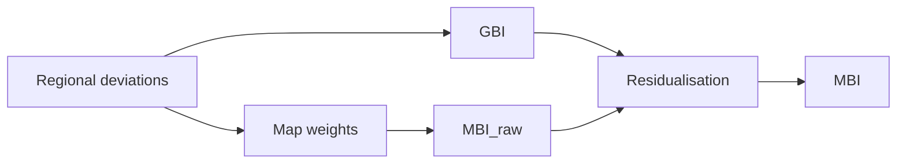

# MBI-pipeline

A modular R pipeline for computing the **Metabolic Brain Index (MBI)** from structural MRI. Regional normative deviations are weighted by a region-wise brain map and expressed as a spatial contrast. The reference map is an FDG-PET atlas of cerebral glucose metabolism, but any region-wise map (receptor density, gene expression, myelin) can be used instead.

Each stage runs from the command line, all paths and parameters live in one YAML config, and stages can be run separately or in sequence.

## Indices

Three scores are computed per subject:

| index | definition |
|---|---|
| GBI | unweighted mean of the regional deviations (Global Brain Index) |
| MBI_raw | map-weighted mean of the same deviations |
| MBI | standardised residual of MBI_raw on GBI |

Because MBI_raw and GBI average the same deviations, MBI is a linear contrast of the regional deviations along the map. The R² between MBI_raw and GBI therefore does not bear on MBI, which `extras/verify_invariance.R` checks against the implementation. MBI is orthogonal to GBI and has unit variance in the sample it was computed on, so re-residualise within any subset you analyse.



## Quick start

```bash
Rscript examples/toy/run_toy_example.R      # synthetic data, no inputs needed
```

For your own data, copy `config_generic.yaml`, edit it, and run `scripts/run_all.sh`. The driver reads its paths from environment variables (`CFG`, `MAPS_DIR`, `FREESURFER_STATS_DIR`, `DEMOGRAPHICS_FILE`, `OUTDIR`); `jobs/mbi_run.sbatch` sets all of them. Single stages take the config and output directory directly:

```bash
Rscript scripts/02_run_normdevs.R -c config.yaml -o out/run1
```

## Repository structure

```
scripts/   stage entry points (01-05) and the drivers run_all.sh and run_sens_all.sh
helpers/   functions sourced by the stages
extras/    feature adapter, PET-map preparation, discovery/replication split, diagnostics
jobs/      example SLURM scripts
examples/  toy example
```

`config_generic.yaml` documents every key. `extras/SELECTION_RULE.md` records the parameter decisions with their dates and grounds.

## Pipeline stages

### Feature adapter (optional)

`extras/prep_features.R` builds `features_wide.tsv` and `feature_map.tsv` from FreeSurfer stats tables: cortical thickness and surface area for the Desikan-Killiany regions, and subcortical volumes. Ventricles are excluded. FreeSurfer 6 and 7 aseg names are both accepted, and the adapter stops if an expected structure is missing.

### Stage 01: extract map values

`scripts/01_extract_petvals.R` parcellates a volumetric map and writes the raw regional median with extraction QC (voxel counts, coverage, within-parcel dispersion). No normalisation happens here; the map-to-weight transform is applied once, in stage 03.

Output: `extract_pet/pet_fdg_featMedians.txt`

### Stage 02: normative models

`scripts/02_run_normdevs.R` fits a location-scale GAM per feature (mgcv `gaulss`, REML). The mean model contains an age spline (k = 10), sex, scanner as a random effect, and ICV for SA and SubVol; the scale model contains an age spline (k = 5), sex and scanner. Each deviation is thereby scaled by the spread expected for the subject's age and sex. A feature is dropped only if its age smooth uses more than `edf_max_frac` of its basis. Models are fitted on everyone or on the discovery half (`split.fit_on`), and all subjects are scored.

Outputs: `normdev/deviations_z_long.txt`, `normdev/feats_avgSize.txt`, `normdev/normative_qc.txt`

### Stage 03: indices

`scripts/03_run_mbi.R` converts the map to weights, pools all features globally and computes GBI, MBI_raw and MBI. It also writes a feature manifest with the fate of every feature, per-feature influence shares, N_eff (inverse Herfindahl of the contrast weights), and per-subject concentration (the largest single-feature share of each subject's score).

Output: `compute_mbi/mbi_flagship_scores.txt`, columns `id | mbi_raw | gbi | mbi`

### Stage 04: map-alignment QC (optional)

`scripts/04_relate_mbi_pet.R` relates the map weights to the MRI deviations through PC1 loadings, leave-one-out contributions and subject-level scatter.

Output: `qc_pet_align/`

### Stage 05: alternative map (optional)

`scripts/05_compare_pet_templates.R` compares the index under two maps, first as weight vectors across regions and then as subject-level MBI_raw, GBI and MBI. Prepare the second map with `extras/prep_petmap_alt.sh`; `scripts/run_sens_all.sh` runs the comparison with every index parameter taken from the canonical run. Report the agreement for MBI, since MBI_raw agreement mostly reflects the shared MRI.

Output: `compare/`

## Configuration

```yaml
mbi:
  emphasis: 1           # contrast shape; the only parameter that changes MBI
  clamp_z: 3            # bound on the robust z of the map
  ratio: auto           # weight scale; cancels out of MBI
  beta: 0               # size weighting: 0 = topography, 1 = tissue volume
  coverage_thr: 0.80    # completeness required per subject and modality
  required_modalities: ["CT", "SA", "SubVol"]
  subvol_min_mm3: 1000  # drop subcortical structures below this volume
  # z_implausible: 10   # set deviations beyond this |z| to missing
```

At `emphasis = 1` the weights are linear in the map and the index has no free parameter. Higher values concentrate influence on fewer regions; `extras/sweep_emphasis.R` reports this together with `beta`. `z_implausible` sets extreme deviations, typically segmentation failures, to missing rather than clipping them. Fix the parameters before looking at outcomes and record them in `extras/SELECTION_RULE.md`. Stage 03 warns about config keys it does not read.

## Discovery/replication split

With `split.mode: hash`, each subject is assigned to discovery or replication by a deterministic function of the subject ID and `split.label`. Assignments stay fixed when subjects are added, and stage 02 recomputes them from the config, so no split file can go out of date. `extras/make_split.R` writes the assignment and its balance by sex and age for downstream analyses. `split.fit_on` controls only who the normative models are fitted on.

## Region handling

Deviations are oriented so that higher values mean a healthier brain: larger is healthier for CT, SA, SubVol and FA, and smaller for MD, RD and WMH; other modalities are dropped. Ventricles are excluded because their FDG signal is partial-volume contamination. Subcortical structures below `subvol_min_mm3` are dropped as the least reliably segmented, with an absolute threshold so the gate does not depend on other filtering. GBI and MBI_raw are always built on the same features.

## Diagnostics

| script | purpose |
|---|---|
| `extras/verify_invariance.R` | confirms that MBI does not depend on the R² between MBI_raw and GBI |
| `extras/verify_normative.R` | confirms that the location-scale model flattens sd(z) across age |
| `extras/verify_split.R` | checks split fraction, balance and stability as the cohort grows |
| `extras/reliability_splithalf.R` | split-half reliability from indices built on each hemisphere |
| `extras/sweep_emphasis.R` | sensitivity to `emphasis` and `beta` |
| `extras/region_centroids.R` | region centroids for spatial null models |

The `verify_*` scripts and the toy example run on synthetic data.

## Reproducibility

Every stage writes `run_info.txt` with the pipeline version, config, timestamp, R version, parameters and package versions. `deviations_z_long.txt` is written in a fixed row order, so two runs are byte-comparable.

## License and citation

MIT. If you use this pipeline in academic work, please cite it via `CITATION.cff`.

## Contributing

Bug reports and feature requests are welcome. Please include the stage, a minimal config snippet and the relevant log output.
