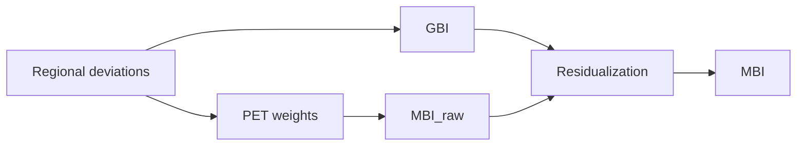

# MBI-pipeline

A modular R-based pipeline for computing **Metabolic Brain Index (MBI)** metrics by integrating MRI-based normative deviations with PET-derived metabolic priors.

This repository is designed to be:
- Self-contained: each stage is runnable end-to-end from the command line.
- Generalizable: minimal assumptions about cohort or dataset specifics; paths and parameters live in a config file.
- Composable: run the full pipeline or only the stages you need.

---

## Conceptual overview

### **1. GBI — Global Brain Index**
Unweighted whole-brain deviation score (size-weighted mean of regional deviations across modalities).

### **2. MBI_raw — PET-weighted deviation index**
Weighted deviation score using region-specific PET metabolic weights.

### **3. MBI — alignment metric**
Residual of the model:

    MBI_raw ~ GBI

This isolates PET-weighted deviation **not explained by global deviation**, making MBI the primary interpretable alignment measure.

---

## Conceptual diagram



---

## Quick run example

From the repository root, run the toy example with:

```
Rscript examples/toy/run_toy_example.R
```

Expected outputs include computed indices and basic QC summaries written to the toy example output directory.

---

## Conceptual workflow

1. **PET feature extraction**  
   Parcellate PET maps and derive region-wise metabolic weights.

2. **Normative modelling (MRI)**  
   Estimate region-wise deviations (e.g. z-scores) from a normative model with covariates.

3. **Index computation**  
   Aggregate deviations into GBI, MBI_raw, and MBI.

4. **PET-MBI alignment QC (optional)**  
   Evaluate how PET weights relate to MRI deviations and derived indices.

5. **Alternative PET template comparison (optional)**  
   Cross-validate against alternative FDG-PET templates to assess template sensitivity.

---

## Repository structure

```
scripts/   Command-line entrypoints for each pipeline stage.
helpers/   Reusable functions sourced by scripts (normative modelling, PET extraction, aggregation, QC).
extras/    Optional utilities: FreeSurfer-table adapter, PET-map prep, calibration grid.
jobs/      Example SLURM batch scripts for running the pipeline on HPC systems.
examples/  Toy example for smoke-testing.
```

`config_generic.yaml` — example configuration file defining inputs, outputs, and modelling parameters.
`DESCRIPTION` — package-style metadata (dependencies, authorship, license).

---

## Pipeline stages

### Stage 01 — Extract PET values
**Script:** `scripts/01_extract_petvals.R`  
**Helpers:** `helpers/pet_parcel_extract.R`

Parcellates PET maps and computes region-wise PET summaries (median FDG uptake by default).

**Key output:** `out/extract_pet/pet_fdg_featMedians.txt`

---

### Stage 02 — Run normative modelling
**Script:** `scripts/02_run_normdevs.R`  
**Helpers:** `helpers/normative_modeling.R`

Fits region-wise GAM normative models (mgcv, REML, k=10 for age smooth) and outputs deviation scores with QC summaries. Optional discovery/replication split via `TRAIN_IDS` environment variable.

**Key outputs:**
```
out/normdev/deviations_z_long.txt
out/normdev/feats_avgSize.txt
out/normdev/normative_qc.txt
```

---

### Stage 03 — Compute MBI indices
**Script:** `scripts/03_run_mbi.R`  
**Helpers:** `helpers/compute_mbi.R`

Aggregates regional deviations into subject-level indices. Default parameters: `gamma=2.5` (PET-weight exponent), `beta=0.25` (size-weight exponent), `winsor_q=0.99` (winsorise PET weights at p99 of positives before exponentiation), `coverage_thr=0.80`, `subvol_gate_pct=0.20` (drop smallest p20 of SubVol regions).

**Key output:** `out/compute_mbi/mbi_flagship_scores.txt`

Columns: `id | mbi_raw | gbi | mbi`

---

### Stage 04 — Relate MBI to PET (QC / diagnostics)
**Script:** `scripts/04_relate_mbi_pet.R`  
**Helpers:** `helpers/relate_pet_funcs.R`

Evaluates alignment between PET weights and MRI deviations (PC1 loadings vs PET, LOO contribution vs PET, subject-level scatter).

**Key outputs:** `out/qc_pet_align/`

---

### Stage 05 — Compare alt PET template (optional)
**Script:** `scripts/05_compare_pet_templates.R`  
**Helpers:** `helpers/compare_pet_funcs.R`

Sensitivity analysis comparing MBI under a canonical PET template vs an alternative template. Tier 0: weight-vector regional correlation (raw + after gamma/winsor transform). Tier 1: subject-level construct correlations for MBI_raw, GBI, MBI.

**Workflow:** run the full pipeline with the canonical template, run again with an alt template (use `extras/prep_petmap_alt.sh` to prepare alt atlas/GM), then run this stage. See `scripts/run_sens_all.sh` for a reusable driver.

**Key outputs:** `out/compare/`

---

### Optional: run entire pipeline
**Script:** `scripts/run_all.sh`

Sequentially runs the FreeSurfer adapter (optional) plus stages 01-04 using a single config file.

---

## Configuration

All cohort-specific settings live in a YAML configuration file.

Start by copying:
```
cp config_generic.yaml config.yaml
```

The `mbi:` block defines the index parameters:
```yaml
mbi:
  beta: 0.25
  gamma: 2.5
  alpha: null
  winsor_q: 0.99
  coverage_thr: 0.80
  subvol_gate_pct: 0.20
```

`alpha` can be set to a named list `{CT: 0.3, SA: 0.3, SubVol: 0.4}` to tune modality weights; if `null`, equal weights per available modality per subject.

---

## Region handling notes

### Modalities
Orientation is sign-aligned per modality so that higher values of `z_oriented` correspond to a healthier brain:
- `CT`, `SA`, `SubVol`, `FA` → +1 (more = healthier)
- `MD`, `RD`, `WMH` → -1 (more = worse)
- Other modalities receive orientation 0 and are dropped before aggregation.

### Ventricles
Ventricle regions are excluded from the pipeline upstream in `extras/prep_features.R`. The FDG signal in ventricular voxels is partial-volume artefact rather than biology, so the regions carry no valid metabolic prior. Their MRI volume signal is recoverable from neighbouring atrophy patterns (cortical thinning, hippocampal volume, etc.).

### SubVol size gate
The smallest SubVol regions (CC subdivisions in particular) tend to have unreliable segmentations. The `subvol_gate_pct` parameter drops the bottom p (default 20%) of SubVol regions by mean size.

---

## Running the pipeline

Example (single stage):
```
Rscript scripts/02_run_normdevs.R --config config.yaml
```

Run the canonical pipeline:
```
bash scripts/run_all.sh --config config.yaml
```

Run an alt-template sensitivity:
```
TEMPLATE_LABEL=vaishnavi2010 \
ALT_PET_FILE=/path/to/vaishnavi2010.nii.gz \
CANONICAL_OUTDIR=/path/to/runs/canonical_run \
bash scripts/run_sens_all.sh
```

All scripts are intended to run non-interactively.

---

## Inputs and outputs (contracts)

**Inputs (typical):**
- Subject × region MRI feature table
- Region lookup / feature map
- PET map(s) or precomputed PET region weights
- Covariate table (age, sex, scanner, optional ICV)

**Outputs:**
- Subject-level MBI metrics (GBI, MBI_raw, MBI)
- QC tables and summaries
- Log files

---

## Reproducibility

- All scripts report session information when run.
- Configuration files fully specify analysis parameters.
- The repo includes `LICENSE`, `CITATION.cff`, and a toy example.

---

## License and citation

MIT License. If you use this pipeline in academic work, please cite via the included `CITATION.cff`.

---

## Contributing

Bug reports and feature requests are welcome.
Please include:
- The stage script used
- A minimal configuration snippet
- Relevant log output
