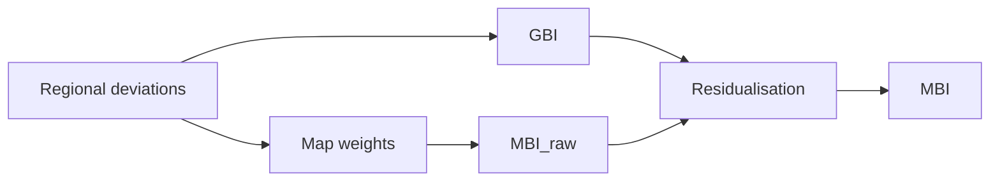

# MBI-pipeline

A modular R pipeline for computing the **Metabolic Brain Index (MBI)**: regional
normative deviations from structural MRI, weighted by a biological brain map,
and expressed as a spatial contrast.

The reference weighting uses an FDG-PET CMRglc atlas, but nothing in the index
is specific to PET. Any region-wise map — receptor density, gene expression,
myelin — can be supplied in its place.

The repository is designed to be:

- **Self-contained** — each stage is runnable end-to-end from the command line.
- **Generalisable** — minimal assumptions about cohort or dataset; paths and parameters live in a config file.
- **Composable** — run the full pipeline or only the stages you need.

---

## What the index is

Three quantities are produced per subject:

| | definition |
|---|---|
| **GBI** | unweighted mean regional deviation — a global brain index |
| **MBI_raw** | map-weighted mean regional deviation |
| **MBI** | standardised residual of `MBI_raw` on `GBI` |

The point that governs how MBI should be read: `MBI_raw` and `GBI` are two
weighted averages of the **same** regional deviations, so their residual is
exactly a linear contrast of those deviations,

```
MBI = sum_r (W_r - b * U_r) * z_r ,  standardised
```

with coefficients summing to approximately zero. MBI is therefore a **difference
between two weighted averages** — a profile score, like a laterality index — and
not "what is left over" after removing global brain structure.

Two consequences follow, both of which are worth stating wherever the index is
reported:

1. A high `R2(MBI_raw, GBI)` is **not** evidence that MBI is empty. It is a
   property of how the two averages were scaled. It moves with the `ratio`
   parameter, which does not change MBI at all —
   `extras/verify_invariance.R` verifies this against the implementation.
2. The question that *does* survive is whether the contrast direction carries
   usable signal-to-noise. That is a **reliability** question, not an R²
   question, and `extras/reliability_splithalf.R` is what answers it.



---

## Quick start

```bash
Rscript examples/toy/run_toy_example.R
```

The toy example is self-contained and needs no external data. It computes the
three indices on a small synthetic cohort and writes indices plus QC summaries
to the toy output directory.

To run on your own data:

```bash
cp config_generic.yaml config.yaml     # then edit paths and parameters
bash scripts/run_all.sh --config config.yaml
```

Individual stages run the same way:

```bash
Rscript scripts/02_run_normdevs.R --config config.yaml
```

All scripts are intended to run non-interactively.

---

## Repository structure

```
scripts/   Command-line entrypoints for each pipeline stage.
helpers/   Reusable functions sourced by scripts (normative modelling, map
           extraction, aggregation, QC).
extras/    Optional utilities: FreeSurfer-table adapter, PET-map prep,
           discovery/replication split, parameter sensitivity sweep, split-half
           reliability, invariance/normative/split verification, region
           centroids.
jobs/      Example SLURM batch scripts for HPC systems.
examples/  Toy example for smoke-testing.
```

`config_generic.yaml` — annotated example configuration.
`DESCRIPTION` — package-style metadata (dependencies, authorship, license).
`extras/SELECTION_RULE.md` — the parameter selection rule and its dated amendments.

---

## Pipeline stages

### Stage 01 — Extract map values

**Script:** `scripts/01_extract_petvals.R` · **Helpers:** `helpers/pet_parcel_extract.R`

Parcellates a volumetric map and emits the **raw** region-wise summary (median
by default), together with the QC columns from extraction — voxel counts,
coverage, and within-parcel dispersion `(p95 − p05) / median`.

No normalisation happens here. The map → weight transform lives in exactly one
place, `transform_map_weights()` in `helpers/compute_mbi.R`, and this stage must
not duplicate any part of it.

Dispersion is worth reading before going further: a large, heterogeneous parcel
can have a perfectly valid median that nonetheless summarises nothing in
particular. It is outcome-blind and map-side, which makes it a defensible basis
for excluding a region — preferable to excluding regions by identity.

**Key output:** `out/extract_pet/pet_fdg_featMedians.txt`

### Stage 02 — Normative modelling

**Script:** `scripts/02_run_normdevs.R` · **Helpers:** `helpers/normative_modeling.R`

Fits region-wise GAM normative models (mgcv, REML) and emits deviation z-scores
with QC summaries. A feature is dropped only when its age smooth has absorbed
the signal (`normative.edf_max_frac * k_age` per age smooth). The former low-r2
arm is off unless `normative.min_r2` is set: a region whose morphometry barely
depends on age still yields a valid z-score, and dropping it removed a spatially
patterned subset of a spatial contrast. The default is a **location-scale** model (`gaulss`): both the
conditional mean and the conditional spread are modelled as functions of age,
sex and scanner, so each subject is scored against their own expected spread.

This is not a refinement. With one scalar sigma per feature, |z| is inflated at
the ages where a feature is most variable; because MBI is a spatial contrast,
and the variance-by-age slope differs between regions, that inflation is
*spatially patterned* — and spatially patterned inflation of z is arithmetically
indistinguishable from genuine deviation topography.

Optionally fits on the discovery half only (`split.fit_on: discovery`, or an
external list via `TRAIN_IDS`); z-scores are computed for everyone either way.
A `TRAIN_IDS` path that does not exist is now an error rather than a silent
fallback to fitting on the whole cohort.

**Key outputs:**

```
out/normdev/deviations_z_long.txt
out/normdev/feats_avgSize.txt
out/normdev/normative_qc.txt
```

### Stage 03 — Compute the indices

**Script:** `scripts/03_run_mbi.R` · **Helpers:** `helpers/compute_mbi.R`

Aggregates regional deviations into subject-level indices, pooling **globally**
over all features at once — no per-modality nesting and no per-modality mixing
weight.

Alongside the scores this stage writes a complete **feature manifest**: every
feature in the feature map is assigned exactly one fate, so the difference
between "features defined" and "features in the index" is always readable off a
file rather than reconstructed by hand. It also writes per-feature **influence
shares** and `N_eff` (inverse Herfindahl on the contrast weights) — the single
most useful diagnostic of whether a handful of regions is driving the index.
`N_eff` counts *features*, not anatomical locations: a cortical region enters
twice, through CT and through SA, carrying the same map weight both times.

It also writes `mbi_subject_concentration.txt`: per subject, the largest
single-feature share of their own index, the effective number of features behind
it, and the feature responsible. Nothing bounds `z` — stage 02 computes it from
the raw value by design, and `clamp_z` clamps the map rather than the deviation
— so a segmentation failure enters the contrast at full weight. On a synthetic
build at `N_eff` 70, one feature forced to `|z| = 8` moved that subject's MBI by
1.6 SD. Read `top_share`, not `max_abs_z`: a large deviation on a low-influence
feature is harmless, a moderate one on a high-influence feature may not be.

**Key output:** `out/compute_mbi/mbi_flagship_scores.txt`, columns
`id | mbi_raw | gbi | mbi`

> **`mbi` is sample-dependent.** Both the slope of `mbi_raw` on `gbi` and the
> standardisation are estimated on the subjects scored in this run, so `mbi` is
> orthogonal to `gbi` and has SD 1 *in that sample and no other*. If you
> subsequently analyse a subset — a diagnostic group, or the complete cases for
> a particular outcome — the column you are carrying is no longer orthogonal to
> `gbi` and no longer standardised, and any claim that MBI is independent of
> global brain structure no longer holds for it. Re-residualise within the
> analysed subset instead of reusing this column.

### Stage 04 — Map-alignment QC (optional)

**Script:** `scripts/04_relate_mbi_pet.R` · **Helpers:** `helpers/relate_pet_funcs.R`

Diagnostics on how map weights relate to MRI deviations: PC1 loadings against
the map, leave-one-out contribution against the map, subject-level scatter.

**Key outputs:** `out/qc_pet_align/`

### Stage 05 — Alternative-template comparison (optional)

**Script:** `scripts/05_compare_pet_templates.R` · **Helpers:** `helpers/compare_pet_funcs.R`

Sensitivity analysis comparing the index under two maps. Tier 0 correlates the
weight vectors across regions, raw and after the weight transform; Tier 1
correlates subject-level `MBI_raw`, `GBI` and `MBI`.

Quote the **MBI** figure rather than the `MBI_raw` figure. `MBI_raw` is highly
correlated with `GBI` by construction, so its cross-template agreement says more
about the MRI than about the map being tested.

**Workflow:** run the pipeline with each map (`extras/prep_petmap_alt.sh`
prepares an alternative atlas/GM pair), then run this stage.
`scripts/run_sens_all.sh` is a reusable driver; it builds its config by
inheriting every index parameter from the canonical run, because a sensitivity
run built at different parameters from the run it is compared against measures
the parameters rather than the map.

**Key outputs:** `out/compare/`

---

## Configuration

All cohort-specific settings live in a YAML config. Start from
`config_generic.yaml`, which annotates every key.

The `mbi:` block defines the index:

```yaml
mbi:
  emphasis: 1           # the only parameter that changes MBI
  clamp_z: 3            # safety rail on outlier parcels
  ratio: auto           # weight scale, read off the map; inert for MBI
  beta: 0               # 0 = topography, 1 = burden
  coverage_thr: 0.80
  required_modalities: ["CT", "SA", "SubVol"]
  subvol_min_mm3: 1000
  # z_implausible: 10   # optional; see below
```

**`z_implausible`** treats a deviation above this magnitude as MISSING, not
clipped, before aggregation. Nothing else bounds `z` — stage 02 computes it from
the raw value by design and `clamp_z` bounds the map — so a failed segmentation
otherwise enters the contrast at full weight, and because the index spreads
influence deliberately thinly, one absurd value dominates by accident. Clipping
does not fix that: it asserts a value the data does not support, and on a
143-feature build an artefact clipped at 5 still moved its subject by 1.7 SD,
against 0.36 SD when the observation was dropped instead. Set the bound outside
the biological range rather than at its edge — severe atrophy reaches `|z|` of 5
to 8 legitimately — and read your own distribution first.

**`emphasis`** applies `u -> sign(u) * |u|^emphasis` before the weight mapping.
At the default of 1 the transform is inactive and the weights are affine in the
map's robust z, so MBI is a plain linear contrast along the biological gradient.

That default matters more than it looks. At `emphasis = 1` the index has **no
free parameters at all** — `ratio` is algebraically inert, `clamp_z` is a safety
rail, `beta` is 0 — so there is nothing in the construction that could have been
tuned to produce a result. Values above 1 buy a hypothesis (that demand relates
non-linearly to vulnerability, with both extremes disproportionately affected)
at a real cost in concentration: on a reference cohort `N_eff` more than halved
between emphasis 1 and 2 and fell by roughly three quarters by 3, while the
largest single feature share doubled and then quadrupled. Measure it on your own
build with `extras/sweep_emphasis.R`. Raise it only with a stated reason, and record
that reason in `extras/SELECTION_RULE.md`.

**`ratio`** sets the weight scale and cancels out of MBI. Setting it to the map's
own observed max:min makes the scale self-documenting. It cannot be tuned to
change a result.

**`beta`** chooses the question: 0 treats every standardised regional deviation
as one observation of a spatial pattern; 1 weights by tissue volume, which is
parcellation-invariant but concentrates influence on large structures.

Report `emphasis ∈ {1, 2, 3}` and `beta ∈ {0, 1}` as a sensitivity strip
(`extras/sweep_emphasis.R`). Fix the parameters and record them in
`extras/SELECTION_RULE.md` *before* inspecting any outcome; the sweep reports
sensitivity, it does not select.

Keys the pipeline does not read — `pooling`, `map_method`, `alpha`,
`alpha_theta`, `gamma`, `winsor_q` — are rejected by stage 03 with a warning, as
is `subvol_gate_pct`, so a config always documents what actually ran.

---

## Discovery and replication

The `split:` block assigns every subject to a discovery or replication half.
The assignment is a deterministic function of the subject identifier and a short
label naming the split,
which buys the two properties a split has to have:

- **It does not move.** Adding subjects leaves every existing assignment
  untouched. A stratified redraw does not: `sample()` reshuffles everyone when
  N changes, and its random stream changed at R 3.6, so a seed does not pin a
  split across environments.
- **It does not go stale.** There is no file to regenerate. Freezing a draw in a
  file stops the movement but starts a subtler failure: under an `id %in%
  train_ids` rule every subject added afterwards silently lands on the held-out
  side, and the realised discovery fraction falls with each cohort refresh.

`extras/make_split.R` writes the assignment for the analyses that consume it,
together with the realised balance by sex and age decile — what stratification
would have imposed, reported instead. Stage 02 recomputes the same assignment
from the same two config values rather than reading that file, so the two cannot
fall out of step.

**What the split does and does not control here.** `split.fit_on` decides who
the normative models are fitted on, and nothing else. Every subject is scored
either way and the index is built identically for both halves. The default is
`all`, deliberately: the normative model contains no outcome, only age, sex,
scanner and optionally ICV, so fitting it on the whole cohort is not leakage with
respect to a later association test — it is the more precise estimate of the
norms. Discovery/replication logic belongs where an outcome enters, downstream
of this pipeline, which is what the written assignment is for. `fit_on:
discovery` is a sensitivity arm asking whether the deviations depend on who the
norms were built from; it changes every index value, so give it its own output
directory.

`split.label` is just a fixed string naming the split — anything stable and
descriptive, e.g. `"mbi-2026a"`. Changing it draws a different split. That is its only purpose and it is not
a tuning knob — a label changed after outcomes have been inspected is a split
chosen against a result. Record any change in `extras/SELECTION_RULE.md`. Stage
02 records the mode, label, requested and realised fractions and a checksum of
the discovery set in `run_info.txt`, so whether two runs used the same split is
a string comparison.

---

## Region handling

### Orientation

Signs are aligned per modality so that higher `z_oriented` always means a
healthier brain:

- `CT`, `SA`, `SubVol`, `FA` → +1 (more = healthier)
- `MD`, `RD`, `WMH` → −1 (more = worse)

Modalities not listed receive orientation 0 and are dropped before aggregation.

### Ventricles

Excluded upstream in `extras/prep_features.R`. FDG signal in ventricular voxels
is partial-volume contamination rather than biology, so the regions carry no
valid metabolic prior. Their MRI volume signal is largely recoverable from
neighbouring atrophy measures.

### SubVol size gate

Small subcortical structures are segmented least reliably, so their deviations
are dominated by measurement noise. `subvol_min_mm3` drops structures below an
absolute volume — deliberately absolute rather than a quantile, so the gate is
invariant to upstream region filtering and commutes with the map-validity
filter. Set it from your own segmentation's volume distribution.

Where a repeat-imaging visit exists, a per-feature test-retest ICC gate across
all modalities is the better instrument; set `inputs.feat_icc` and `mbi.icc_min`
to use one.

### Feature-set alignment

Both indices are built on identical features, enforced by `align_feature_set()`
and asserted again before residualisation. A region carried in `GBI` but not in
`MBI_raw` would load on the residual purely by construction.

---

## Inputs and outputs

**Inputs**

- Subject × region MRI feature table
- Feature map (`feature` → `modality`, `region`)
- A volumetric brain map, or precomputed region weights
- Covariates: age, sex, scanner, optionally ICV

**Outputs**

- Subject-level indices: `GBI`, `MBI_raw`, `MBI`
- Feature manifest and influence shares
- QC tables and logs

---

## Diagnostics worth running

| script | question it answers |
|---|---|
| `extras/verify_invariance.R` | Does `R2(MBI_raw, GBI)` affect MBI? (No — checked against the implementation over three orders of magnitude in `ratio`.) |
| `extras/verify_normative.R` | Does the location-scale model actually flatten `sd(z)` across age, and recover a known sigma? Checked against `fit_one_feature()` itself. |
| `extras/reliability_splithalf.R` | Does the contrast direction carry signal? Builds the index from disjoint hemispheres and correlates the two. |
| `extras/sweep_emphasis.R` | How much does the result depend on `emphasis` and `beta`? |
| `extras/region_centroids.R` | Inter-region distances, for spatial-autocorrelation-preserving nulls. |
| `extras/make_split.R` | Writes the discovery/replication assignment and its realised balance. |
| `extras/verify_split.R` | Does the assignment give the requested fraction, spread subjects evenly, and stay fixed as the cohort grows? |

The two `verify_*` scripts run standalone on synthetic data and need no cohort:

```bash
Rscript extras/verify_invariance.R
Rscript extras/verify_normative.R
Rscript extras/verify_split.R
Rscript examples/toy/run_toy_example.R
```

---

## Reproducibility

- Every stage writes `run_info.txt` beside its outputs: pipeline version, config path, timestamp, R version and platform, the stage's parameters, and the attached package versions. A directory of results can always be traced to the code that produced it.
- Configuration files fully specify analysis parameters.
- `deviations_z_long.txt` is written in a deterministic row order, so two runs are byte-comparable.
- `LICENSE`, `CITATION.cff` and a toy example are included.

---

## License and citation

MIT. If you use this pipeline in academic work, please cite via `CITATION.cff`.

## Contributing

Bug reports and feature requests are welcome. Please include the stage script
used, a minimal configuration snippet, and the relevant log output.
